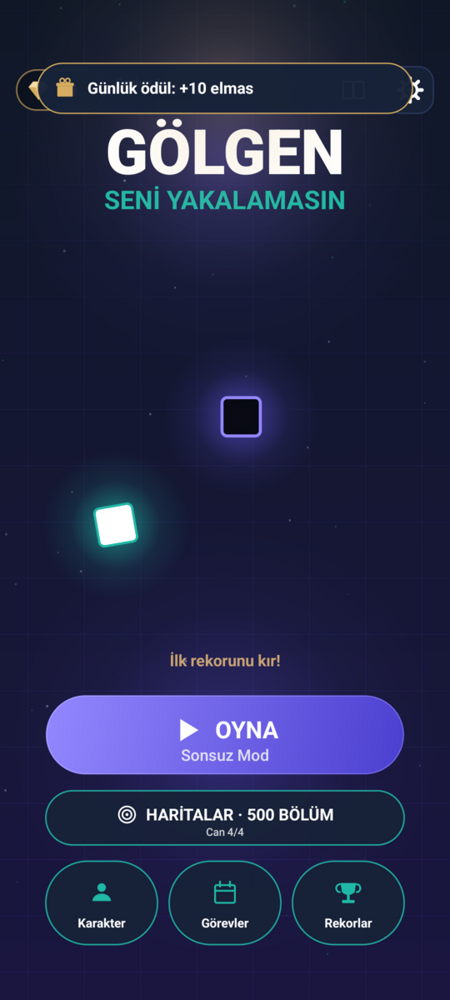
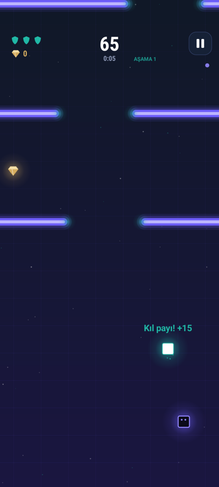
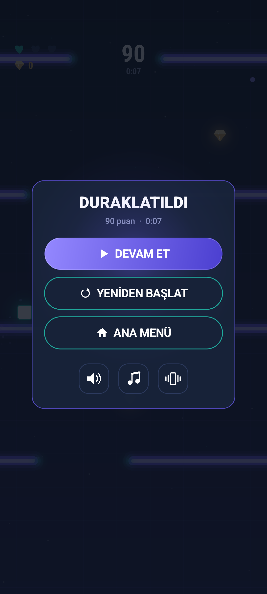
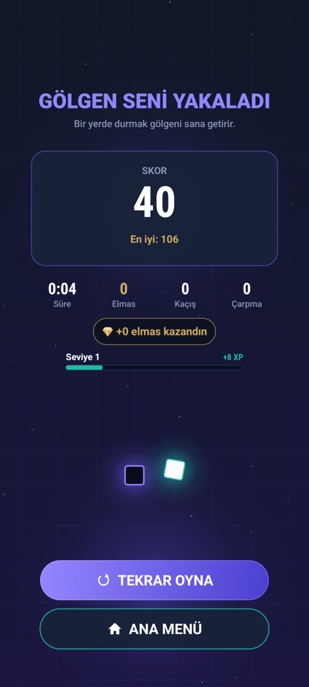
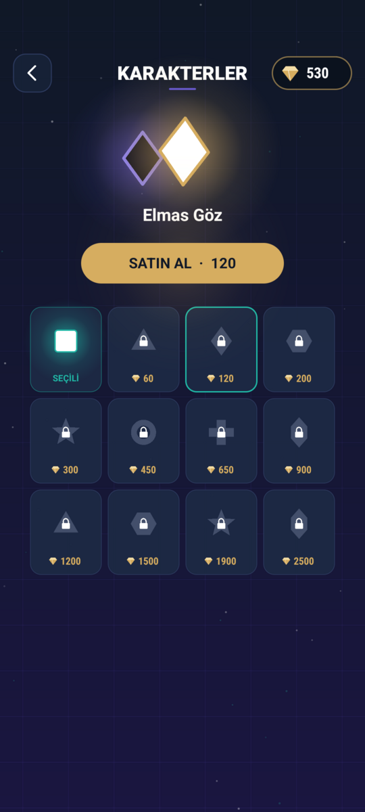
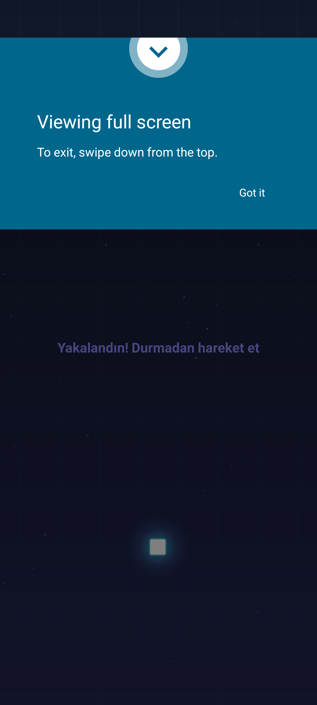
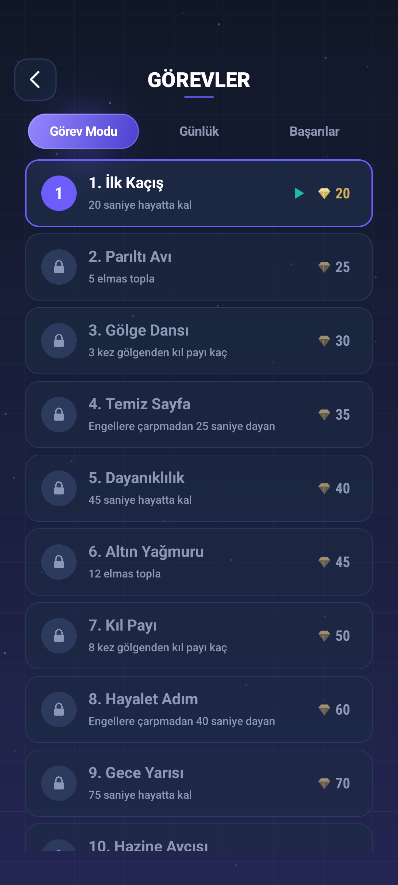
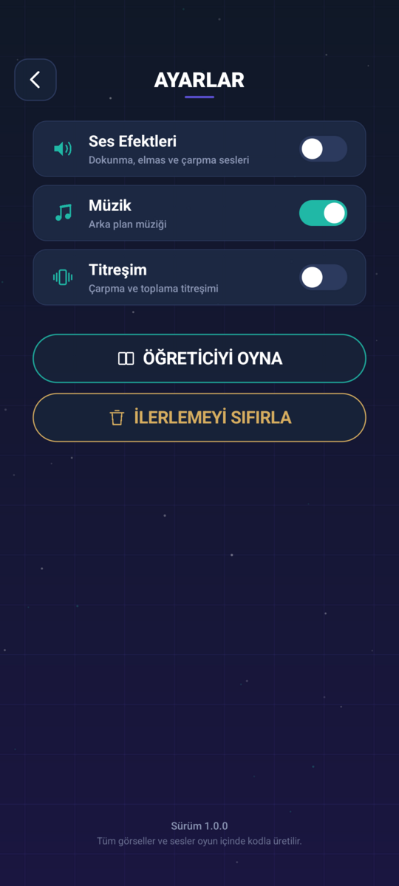

# Gölgen Seni Yakalamasın

Tek parmakla oynanan, dikey (9:16) 2D refleks ve hayatta kalma oyunu. Neon ışıklı karanlık bir dünyada
beyaz geometrik karakterini sürükle; **gölgen birkaç saniye önceki hareketlerini birebir tekrar eder.**
Hem neon engellerden hem de kendi geçmişinden kaçmalısın.

- **Platform:** Android 8.0+ (API 26–35). Çekirdek mantık platformdan bağımsız saf Java olduğu için iOS'a taşınabilir.
- **Teknoloji:** Android Studio projesi, **saf Java**, harici kütüphane yok. Kendi 2D motoru (Canvas + Choreographer, donanım hızlandırmalı).
- **İnternet gerekmez**, sunucu yok. Tüm görseller ve sesler kodla üretilir (lisans gerektiren üçüncü taraf varlık yok).

> Not: İstekte Unity 2D belirtilmişti; talimatın sonunda "Android Studio Java olarak" istendiği ve bu ortamda
> Unity bulunmadığı için proje Android Studio + Java ile geliştirildi. Unity'deki ScriptableObject, prefab ve
> object pooling kavramlarının karşılıkları aşağıda belirtilmiştir.

## Ekran görüntüleri
Android 14 emülatöründe (Pixel 6) otomatik testler sırasında çekildi; her CI çalışmasında yenilenir.

| Ana menü | Oynanış | Duraklatma | Oyun sonu |
|---|---|---|---|
|  |  |  |  |
| **Karakterler** | **Günlük görevler** | **Görev modu** | **Ayarlar** |
|  |  |  |  |

## Açma ve derleme

1. Android Studio'da **File › Open** ile `golgen-seni-yakalamasin/` klasörünü açın (depo kökünü değil).
2. Gradle senkronizasyonu bitince ▶ **Run 'app'**.

Komut satırından:

```bash
cd golgen-seni-yakalamasin
./gradlew testDebugUnitTest      # birim testleri
./gradlew assembleDebug          # app/build/outputs/apk/debug/app-debug.apk
./gradlew assembleRelease        # R8 ile küçültülmüş APK (debug anahtarıyla imzalı)
```

Hazır APK: GitHub Actions her push'ta APK'yı derler, emülatörde test eder ve **Releases** sayfasına
`golgen-v1.0.0-b<N>` etiketiyle yükler (ayrıca `golgen-apk` artefaktı).

> Play Store'a yüklemek için kendi keystore'unuzu oluşturup `app/build.gradle` içindeki `release` imzasını değiştirin.

## Oynanış

| Mekanik | Uygulama |
|---|---|
| Tek parmak kontrol | Ekranın herhangi bir yerinde sürükleme; karakter parmağın **göreli** hareketini izler (parmak karakteri örtmez), azami hızla yumuşatılır. |
| Hareket kaydı | `MotionRecorder`: 120 Hz, oyun zamanı damgalı, sabit boyutlu halka tampon (tahsis yok). |
| Gölge | `Shadow` konumu her adımda kayıttan `t − gecikme` anına enterpolasyonla okunur → gerçek hareket geçmişi. |
| Duraklatma | Oyun zamanı yalnızca simülasyon adımında ilerler; duraklatınca kayıt da gölge de donar, gecikme bozulmaz. |
| Yeni gölgeler | Sonsuz modda 3, 20, 40, 62, 88. sn'de farklı gecikmelerle (3,0 / 4,6 / 2,3 / 6,0 / 3,7 sn); en fazla 5 gölge. |
| Gölge belirmesi | Yeni gölge 1 sn boyunca daralan halka ile uyarır, bu sürede zararsızdır. |
| Engeller | Boşluklu duvar, nabız atan mayın, salınan blok, dönen lazer; türler zorlukla açılır. |
| Adil üretim | Duvar boşluğu ≥ 215 birim (karakter çapının ~3,8 katı); ardışık boşluklar arası kayma oyuncu hızına göre sınırlı; dönen lazerin bir yanında her zaman geçiş payı; engeller dikeyde aralıklı. |
| Zorluk | `DifficultyProfile`: kayma hızı, engel sıklığı ve boşluk genişliği 150 sn'de kademeli artar. |
| Can | Engel çarpması 1 can (3 can, 1,5 sn dokunulmazlık). **Gölge teması = anında oyun sonu.** |
| Skor | `süre×10 + elmas×25 + kıl payı kaçış×15`. |
| Kıl payı kaçış | Katı gölge çok yaklaşıp temas etmeden uzaklaşınca sayılır. |

### Modlar
- **Sonsuz Mod:** mümkün olduğunca uzun hayatta kal. Her 30 sn'de yeni **aşama**; zorluk tavana ulaştıktan sonra da
  akış hızlanmaya devam eder (hiç bitmeyen artış). Rekor ve ilk 10 skor cihazda saklanır.
- **Görev Modu:** **5 bölüm × 12 = 60 seviye**. Beş görev türü: hayatta kal, gölgeden kıl payı kaç, elmas topla,
  **engellere çarpmadan** tamamla, **puan hedefi**. Her bölüm yeni zorlaştırıcılar getirir ve bir **bölüm finali** ile biter:
  | Bölüm | Zorlaştırıcı |
  |---|---|
  | 1 · Alacakaranlık | Yok (temel) |
  | 2 · Neon Sokaklar | Hızlı Akış (%25 hızlı) |
  | 3 · Karanlık Labirent | Karanlık: görüş oyuncunun çevresiyle sınırlı |
  | 4 · Gölge Fırtınası | Hızlı Gölgeler (kısa gecikme) + Gölge Akını (erken ve sık gölge) |
  | 5 · Sonsuz Gece | Hepsinin karışımı; final tüm zorlaştırıcılarla |
- **Yıldızlar (180 adet):** ★ tamamla · ★ hiç çarpmadan bitir · ★ kombo hedefine ulaş. Yeni yıldız başına +10 elmas;
  seviyeleri tekrar oynamak için sebep.

### Uzun süreli oynanış
- **Güçlendirmeler:** Kalkan (bir engel veya gölge temasını emer), Yavaş Zaman (dünya %55 hızda akar; gölge geçmişi bozulmaz),
  Mıknatıs (yakındaki elmasları çeker).
- **Kombo çarpanı:** ardışık elmas/kıl payı kaçışlar çarpanı x5'e kadar yükseltir; çarpma veya 4 sn boşluk sıfırlar.
- **Oyuncu seviyesi ve XP:** her oyun XP kazandırır, her seviye elmas ödülü verir.
- **7 günlük giriş serisi:** her gün artan ödül, 7. gün büyük ödül; gün kaçırılırsa seri sıfırlanır.
- **Günlük görevler:** 8 türden her gün 3 farklı görev (güçlendirme topla, görev bitir, kombo yap vb.), üç zorluk kademesi.
- **21 başarı** (20–400 elmas ödül), **12 karakter** (en pahalısı 2500 elmas).

### Ek özellikler
- Elmas toplama ve **12 karakter görünümü** — gölge de seçili şekli alır.
- Programatik **ses efektleri** (8 adet) ve döngüsel synthwave **arka plan müziği**.
- Ses / müzik / titreşim açma-kapama, ilerlemeyi sıfırlama (onaylı).
- İnteraktif **ilk açılış öğreticisi** (3 adım), Ayarlar'dan tekrar oynanabilir.
- Ekranlar arası yumuşak karartma geçişleri, buton basılma animasyonları, parçacıklar, ekran sarsıntısı.

## Ekranlar
Açılış · Ana menü · Oynanış (HUD) · Duraklatma · Oyun sonu · Karakter seçimi · Görevler (Görev Modu / Günlük / Başarılar) · Rekorlar · Ayarlar · Öğretici.
Tüm metinler Türkçe. Renk paleti: Gece laciverti `#101827`, Neon mor `#6D5DFB`, Turkuaz `#20B8A6`, Altın `#D6AD60`, Beyaz `#FFFFFF`.

## Mimari

```
app/src/main/java/com/golgen/oyun/
  MainActivity.java        Tam ekran, dikey, notch/safe-area, geri tuşu
  GameView.java            Choreographer döngüsü, ekran yöneticisi, geçişler, bildirimler, servisler
  core/                    ── Android'den bağımsız, birim testli oyun mantığı ──
    GameWorld.java         Sabit adımlı (1/120 sn) simülasyon: oyuncu, gölgeler, engeller, elmaslar, çarpışma
    MotionRecorder.java    Zaman damgalı hareket geçmişi (halka tampon + ikili arama + enterpolasyon)
    Shadow.java            Gecikmeli tekrar varlığı
    Pool.java              Nesne havuzu (engeller, elmaslar, gölgeler)
    DifficultyProfile.java Zorluk verisi  (ScriptableObject karşılığı)
    MissionDef/Missions    Görev seviyeleri verisi (ScriptableObject karşılığı)
    SkinDef/Skins          Karakter verisi (ScriptableObject karşılığı)
    DailyMissions, Achievements, Progress (kayıt modeli), KeyValueStore
    Synth.java             Ses efekti ve müzik sentezi + WAV yazımı
  platform/                PrefsStore (SharedPreferences), SoundSystem (SoundPool + MediaPlayer), Haptics
  ui/                      Theme, Ui (çizim yardımcıları), Icons (vektör ikonlar), Button, Screen, WorldRenderer, Particles
  screens/                 10 ekran
```

**Performans:** oyun döngüsünde bellek tahsisi yok (havuzlar, önceden oluşturulan Paint/Path, önbelleğe alınmış
HUD metinleri, dokuya önceden işlenmiş ışıma), donanım hızlandırmalı Canvas, ekran yenilemesine senkron güncelleme
(60 Hz hedef; 90/120 Hz ekranlarda da sabit adımlı simülasyon aynı davranır). Farklı ekranlar için arayüz
1080×1920 tasarım birimine göre ölçeklenir; sistem çubukları ve kamera çentiği (safe area) hesaba katılır.

## Testler
- `app/src/test/...` — 47 JUnit testi (oyun döngüsünde bellek tahsisi olmadığını ölçen test dahil): gölge gecikme doğruluğu, duraklatmada zamanın donması, hareketsiz kalınca yakalanma,
  determinizm, çarpışmalar, elmas toplama, gölge sınırı, adil engel üretimi (botla 20 tohum), görev kazanma/kaybetme,
  kayıt sistemi gidiş-dönüş, satın alma, günlük görevler, ses sentezi ve WAV başlığı.
- `tools/smoke_test.sh` — emülatörde uçtan uca test (CI): kurulum, öğretici, tüm menü butonları ve ekran geçişleri,
  oynanış, duraklatma, gölge yakalaması, satın alma, ayarların kaydı, uygulama yeniden açıldığında kalıcılık, çökme/ANR kontrolü
  ve ekran görüntüleri. Debug derlemede ekranlar dokunma hedeflerini `GolgenUI` etiketiyle loglar.

Sonuçlar: [`docs/TEST_RAPORU.md`](docs/TEST_RAPORU.md) · Derleme: [`docs/BUILD_RAPORU.md`](docs/BUILD_RAPORU.md)
