# Yeraltı İmparatorluğu: Koloni Savaşları

Android için tek oyunculu, tamamen çevrimdışı, bölümsüz ve sürekli ilerleyen koloni stratejisi.
**Kotlin + libGDX**, dikey 9:16, açık ve sıcak renkli 2D yeraltı kesit görünümü. Reklam yok, gerçek para yok.

> Kaz, üret, geliştir, savun, keşfet ve imparatorluğunu büyüt.

| Hoş geldiniz | Koloni | Yakın çekim | Savaş |
|---|---|---|---|
| 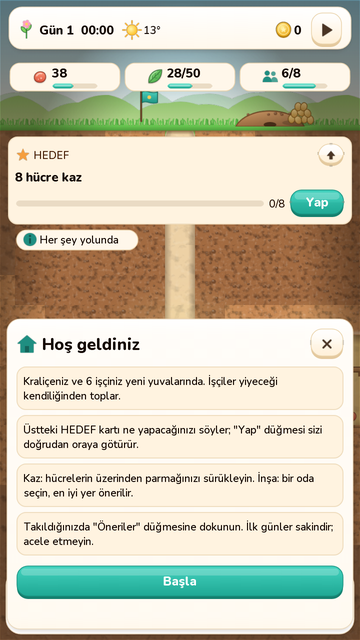 |  | 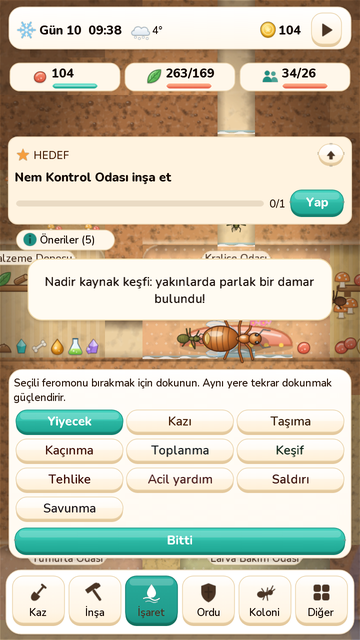 | 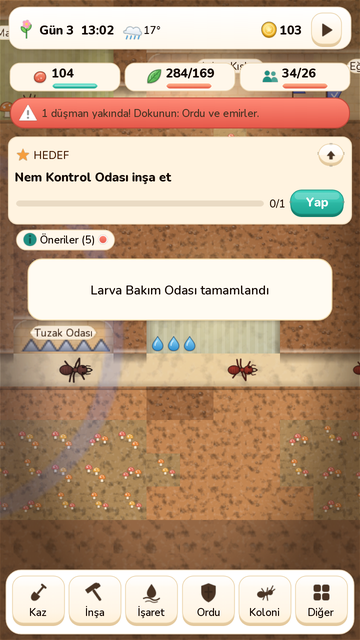 |
| **Öneriler** | **İnşa** | **Araştırma** | **Ordu** |
| 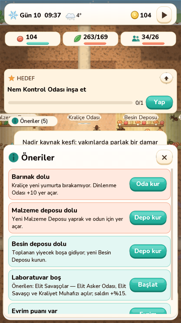 | 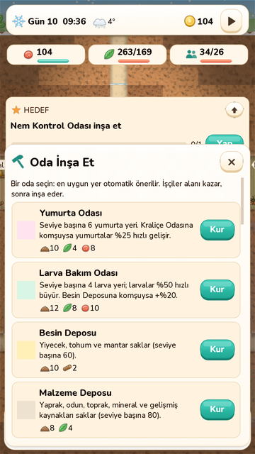 | 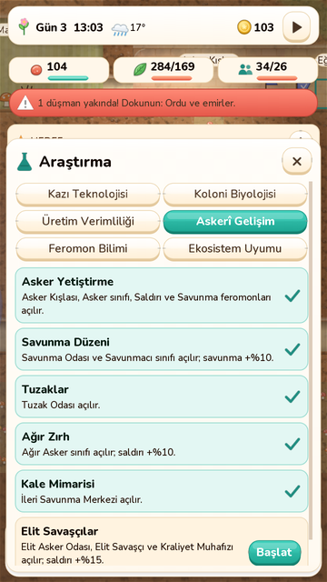 | 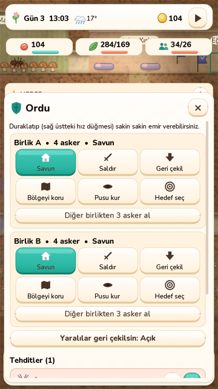 |
| **Diplomasi** | **Diğer** | **Sağanak** | **Kış** |
| 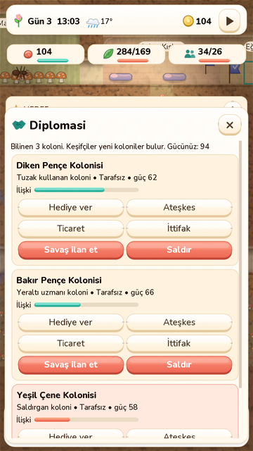 | 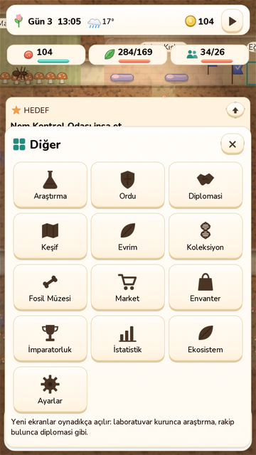 | 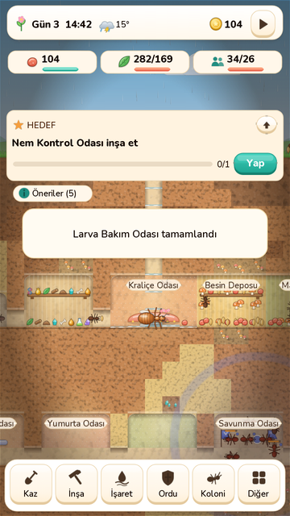 | 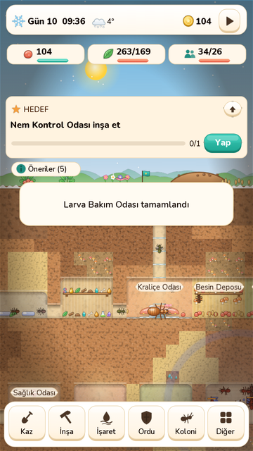 |

Görüntüler masaüstü başlatıcısının sanal ekranda (Xvfb) çalıştırılmasıyla alınmıştır.

## Tasarım ve kolay oynanış

- **Görseller:** 248 çizim `tools/art/` altındaki Python betiğiyle vektör (SVG) olarak üretilir: gradyanlı ve gölgeli
  karıncalar (4 kareli yürüyüş), dikişsiz dokulu zemin karoları, yuvarlatılmış tünel köşeleri, desenli ve ışıklı
  odalar, paralaks tepeler, biyom süsleri, ikonlar ve 9 parçalı arayüz zeminleri. Chromium bunları tek bir 2048×2048
  doku atlasına (`assets/art/game.png` + `game.atlas`) dönüştürür. Yeniden üretmek için: `cd tools/art && python3 build_art.py`.
- **Yazı tipi:** Nunito (SIL Open Font License, `assets/fonts/Nunito-OFL.txt`).
- **Sade arayüz:** Üstte tek bilgi kapsülü ve 3 kaynak çipi; altta büyük ikonlu Kaz / İnşa / İşaret / (Ordu) /
  Koloni / Diğer. Gelişmiş ekranlar ancak ilgili özellik açılınca "Diğer" menüsünde görünür.
- **Rehberlik:** HEDEF kartındaki "Yap" düğmesi oyuncuyu doğrudan ilgili araca götürür; "Öneriler" danışmanı
  (yiyecek, barınak, depo, sel, tehdit, araştırma…) tek dokunuşla uygulanabilir çözümler sunar.
- **Otomatik yerleşim:** Oda seçilince komşuluk bonusunu, kazı miktarını ve su riskini gözeten en iyi yer önerilir.
- **Zorluk:** Rahat (varsayılan: daha az açlık, ilk 6 gün baskın yok, küçük baskınlar, nadir çökme), Normal, Zor.

## Aşamalar

| Aşama | İçerik | Durum |
|---|---|---|
| 1 — Oynanabilir temel | Proje, chunk tabanlı tohumlu dünya, gerçek kazı, A* yol bulma, işçi yapay zekâsı, toplama, ilk odalar, sürümlü kayıt | ✅ |
| 2 — Koloni simülasyonu | Üreme (yumurta → larva → pupa), nüfus/barınak, depolama, üretim, görev öncelikleri, uzmanlar, feromonlar | ✅ |
| 3 — İnşa ve ekonomi | 25 oda, 6 kategoride 32 araştırma, üretim zincirleri, 6 gelişmiş kaynak, sert kaya kazma | ✅ |
| 4 — Ekosistem | 4 mevsim, hava (açık/bulutlu/yağmur/sağanak/kuraklık), sıcaklık, nem, hücresel su akışı ve sel, 8 dünya olayı | ✅ |
| 5 — Savaş ve rakipler | 15 karınca sınıfı, 8 kişilikte ekonomik rakip koloni, baskınlar, gerçek zamanlı taktik savaş, 9 canlı türü | ✅ |
| 6 — Süreklilik | Evrim (5 yol, hibrit), diplomasi, sonsuz keşif seferleri, genetik koleksiyon, fosil müzesi, 20 başarım, itibar, federasyon, imparatorluk hedefleri, market | ✅ |
| 7 — Yayın hazırlığı | Kodla sentezlenen sesler, animasyonlar, kalite ayarı, performans testi, R8 küçültmeli release yapılandırması, imzalama şablonu, Play kontrol listesi | ✅ (cihazda deneme hariç, aşağıya bakın) |

## Oyun sistemleri

**Dünya ve kazı.** Dünya 32×32 parçalardan tohumla üretilir; yalnızca değişen parçalar kaydedilir. 18 hücre türü:
yumuşak/sert toprak, kil, kum, kaya, su taşıyan katman, mantar, mineral ve nadir mineral damarı, fosil, eski yuva
(erzak/fosil/genetik örnek çıkar), canlı yuvası (açılınca avcı uyanır), yeraltı gölü (delinince su boşalır),
rakip tünelleri, moloz ve dolgu. Keşif sisi vardır. Kazı süreleri zemine göre değişir, karıncalar yalnızca kazılmış
tünellerden yürür, dar tünellerde trafik yavaşlatır. Gevşek tavanlı ≥2 hücre yüksekliğindeki geniş boşluklar çöker.
**Doldur** aracı tünel kapatır (savunma, sel kontrolü, rakip bağlantısını kesme).

**Odalar (25).** Kraliçe, Yumurta, Larva Bakım, Besin/Malzeme/Su Deposu, Mantar Çiftliği, Dinlenme, Kışla, Eğitim,
Araştırma Laboratuvarı, Savunma, Tuzak, Havalandırma, Nem Kontrol, Sağlık, Keşif Merkezi, Ticaret, Genetik,
Özel Üretim, Fosil Müzesi, Arşiv, İleri Savunma Merkezi, Elit Asker Odası, Kraliyet Merkezi. Her birinin maliyeti,
alanı, işlevi, kapasitesi, günlük bakımı, 3 seviyesi, işçi ihtiyacı (istasyon odaları) ve komşuluk bonusu vardır.

**Ekonomi.** 14 kaynak; üç depo türü (besin, malzeme, su). Zincirler: yaprak → mantar çiftliği → besin; odun → reçine;
mantar + su → enzim; mineral → nadir mineral; enzim + yiyecek → kraliyet özü; genetik örnek → kalıcı özellik.

**Karıncalar (15 sınıf).** Kraliçe, işçi, toplayıcı, kazıcı, taşıyıcı, bakıcı, keşifçi, şifacı, mühendis,
tünel uzmanı, asker, ağır asker, savunmacı, elit savaşçı, kraliyet muhafızı. Can, enerji, açlık, taşıma, hız,
verim, saldırı, savunma, deneyim ve görev türü. İşçi sınıfları görev yapay zekâsını kendi öncelikleriyle, askerler
ayrı bir savaş yapay zekâsıyla hareket eder. Sınıflar Eğitim Odasında yetiştirilir.

**Görevler ve feromonlar.** 11 görev kategorisi (savunma, kazı, inşa, toplama, taşıma, üretim, larva bakımı,
araştırma, keşif, onarım/dolgu, temizlik) 1–5 öncelikle ya da kapalı; uzman grupları. 10 feromon: yiyecek, kazı,
taşıma, kaçınma, toplanma, keşif, tehlike, acil yardım, saldırı, savunma; zamanla söner, araştırmayla güçlenir.

**Ekosistem.** Mevsimler (3'er gün) kaynak miktarını, sıcaklığı ve yağışı değiştirir. Koloni sıcaklığı derinlikle
yumuşar, havalandırma ideale çeker; nem yağmurla artar, kuraklıkla düşer, nem kontrol odası su harcayarak dengeler.
İklim yavru gelişim hızını belirler. Yağmur suyu girişlerden ve su taşıyan katmanlardan sızar, aşağı akar, yana
yayılır, zeminde emilir; derin bir drenaj kuyusu, kum zemin ve Su Deposu koloniyi korur. Su karıncaları yavaşlatır,
boğabilir, yavru odalarına zarar verir (Suya Dayanıklı Odalar araştırması korur). Dünya olayları: sel, kuraklık,
besin bolluğu, hastalık, toprak kayması, rakip baskını, nadir kaynak keşfi, canlı göçü.

**Rakipler ve savaş.** 8 rakip koloni (saldırgan, savunmacı, hızlı çoğalan, kaynak odaklı, tuzakçı, yeraltı uzmanı,
yüzey hâkimi, elit) kendi yiyecek, nüfus, asker ve savunma ekonomisini yürütür ve oyuncunun gücüne göre ölçeklenir.
İlk 3 gün baskın yoktur; baskın büyüklüğü oyuncunun savunmasıyla sınırlanır; oyuncu yokken baskın olmaz. Akıncılar
besin deposunu yağmalamaya çalışır, kayıp verince geri çekilir. İki birliğe emirler: savun, saldır, geri çekil,
bölgeyi koru, toplan, pusu kur (ilk vuruş ×2), hedef seç, destek gönder, rakibe sefer; yaralıları çekme ayarı.
Oyun duraklatılıp emir verilebilir. Tuzak ve savunma odaları, dar geçitler ve tünel kapatma stratejiyi belirler.
Diğer canlılar: termit, örümcek, kırkayak, mağara avcısı (düşman); solucan, böcek larvası, mağara semenderi (av/kaynak).

**Süreklilik.** İtibar unvanları (Küçük Yuva → Efsanevi İmparatorluk), itibara bağlı evrim puanları, sonsuz yeni
bölgeler açan keşif seferleri (oyuncu yokken de sürer), genetik koleksiyon ve canlı ansiklopedisi, 12 fosilli müze,
20 başarım, sınırsız kademeli imparatorluk hedefleri, kaynak gönderen yan koloniler, diplomasi (hediye, ateşkes,
ticaret, ittifak, savaş), sonsuz koloni hedefleri ve dünya günlüğü. Market yalnızca oyun içi jetonla çalışır
(görünümler, taçlar, oda tasarımları, feromon efektleri, dekorasyonlar, araştırma hızlandırıcı, koleksiyon öğeleri);
`PurchaseBackend` arayüzü Google Play Billing'in ileride eklenebilmesi için ayrılmıştır.

**Çevrimdışı ilerleme.** En fazla 8 saat, %50 verimle: toplama, mantar üretimi, tüketim (stok %30'un altına
düşmez), yavru gelişimi, yumurtlama, araştırma, rakip ekonomileri (baskınsız), yan koloniler ve seferler. Kazı, inşa,
savaş ve ölüm yoktur. Saat geri alınırsa ilerleme verilmez (makul koruma; çevrimdışı oyunda kesin değildir).

**Kayıt.** Sürümlü (şu an 2; 1. sürüm kayıtları otomatik dönüştürülür), CRC sağlamalı, geçici dosya + yedekli;
bozuk ana kayıtta yedekten, ikisi de bozuksa dosya kenara alınıp yeni koloni kurulur. 30 sn'de bir ve arka plana
alınınca otomatik kaydedilir.

## Proje yapısı

```
yeralti-imparatorlugu/
  sim/       Saf Kotlin simülasyon (libGDX'siz, JUnit ile test edilir)
             World · Terrain · Pathfinder · Simulation · Jobs · Rooms · Ants · Tasks · Pheromones
             Progression (araştırma/evrim/genetik) · Environment · Events · Creatures · Rivals
             Expeditions · Collections · Federation · Market · Goals · SaveData/SaveManager · OfflineProgress
  core/      libGDX katmanı: Art (kodla çizilen doku atlası, Türkçe FreeType font), SoundFx (kodla sentezlenen sesler),
             WorldRenderer, Hud + Screens (22 ekran), WorldInput (dokun/sürükle/yakınlaştır)
  android/   Android başlatıcı (dikey, tam ekran, minSdk 24, targetSdk 35), release imzalama
  desktop/   Masaüstü başlatıcı + ekran görüntüsü betiği
  assets/    Doku atlası (art/) ve Nunito yazı tipi (fonts/)
  tools/art/ Çizim üreticisi (Python + Chromium/Playwright)
  docs/      Ekran görüntüleri, YAYIN.md (Google Play kontrol listesi)
```

Performans: simülasyon 30 Hz sabit adımda; yol aramaları düğüm ve adım bütçeli; su yalnızca ıslak hücrelerde akar;
yalnızca görünen hücreler çizilir; tüm görseller tek doku atlasında. Testte 300 karınca + canlılar + sağanakla adım
başına ≈0,2 ms ölçüldü. Düşük kalite ayarı süs animasyonlarını, bulutları ve derinlik gölgelendirmesini kapatır.

## Derleme ve çalıştırma

Gereksinimler: JDK 17+, Android SDK 35 (Android Studio ile gelir).

```bash
cd yeralti-imparatorlugu
./gradlew :sim:test                 # 75 otomatik test
./gradlew :android:assembleDebug    # android/build/outputs/apk/debug/android-debug.apk
./gradlew :android:assembleRelease  # R8 küçültmeli; keystore.properties varsa imzalı
./gradlew :android:bundleRelease    # Google Play için AAB
./gradlew :desktop:run              # masaüstünde 9:16 pencere (fare: tıkla/sürükle, tekerlek: yakınlaştır, Esc: geri)
```

Android Studio'da `yeralti-imparatorlugu` klasörünü proje olarak açın. Ekran görüntülerini yeniden üretmek için:
`xvfb-run -a -s "-screen 0 1280x1800x24" ./gradlew :desktop:run -Dyi.shots=$PWD/build/shots -Dyi.scale=1.6`.
GitHub Actions (`.github/workflows/yeralti.yml`) testleri, APK'ları ve ekran görüntülerini her değişiklikte üretir.

## Bilinen sınırlamalar (dürüst durum)

- APK'lar bu ortamda derlendi ama **gerçek bir cihazda veya emülatörde çalıştırılmadı**. Oyun aynı `core` koduyla
  masaüstünde çalıştırılıp ekran görüntüleriyle doğrulandı. R8 küçültmeli release yapılandırması derleniyor;
  çalışma zamanı (özellikle kayıt serileştirmesi) cihazda denenmeli.
- Yayın imzası anahtarı depoda yoktur (`keystore.properties.example` şablonu var). Mağaza görselleri ve politika
  metinleri için `docs/YAYIN.md`'ye bakın.
- Dengeleme otomatik testlerle ve kısa oyun oturumlarıyla yapıldı; uzun süreli oyuncu testleriyle ince ayar gerekir.
