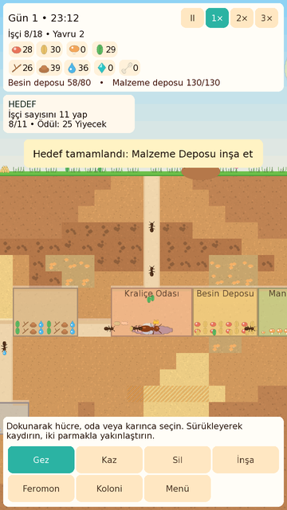
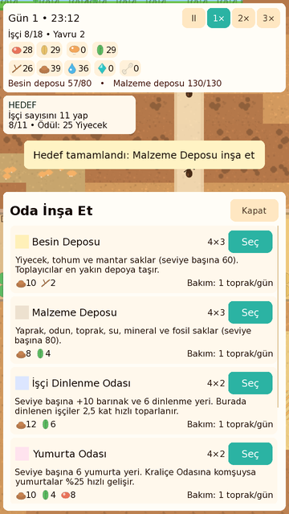
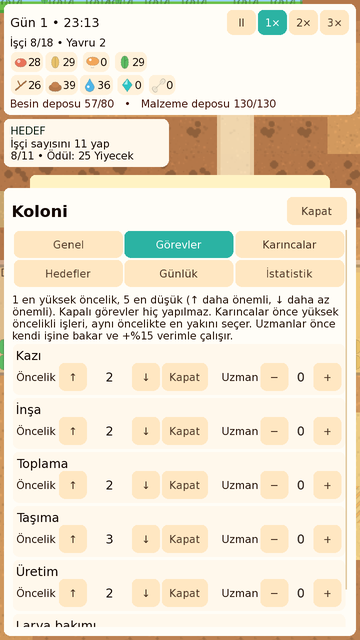
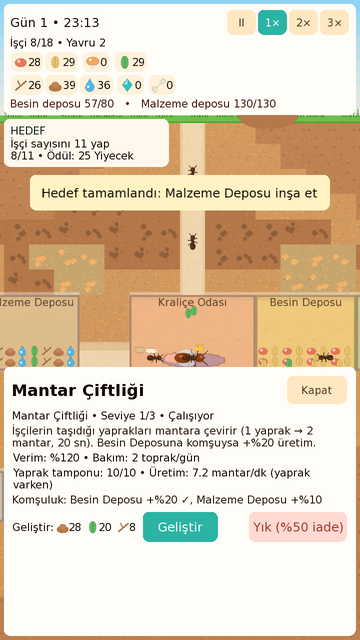
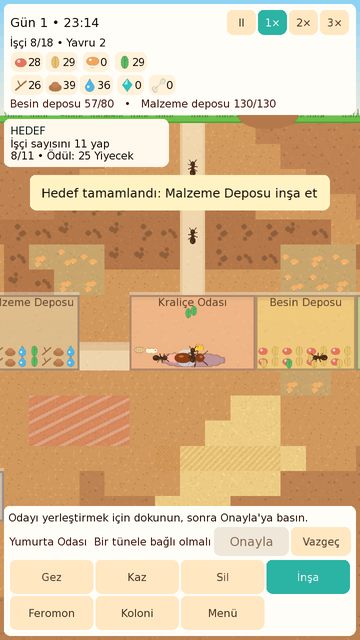
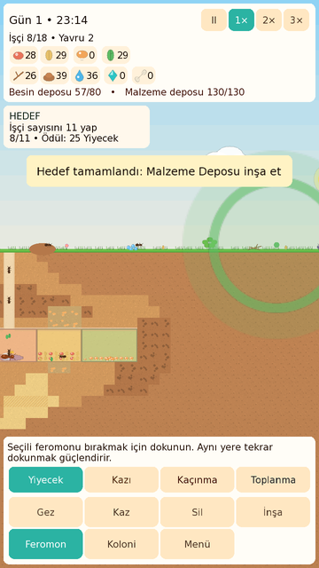

# Yeraltı İmparatorluğu: Koloni Savaşları

Android için tek oyunculu, çevrimdışı, sürekli ilerleyen koloni stratejisi.
**Kotlin + libGDX**, dikey 9:16, açık ve sıcak renkli 2D yeraltı kesit görünümü.

> Bölüm yoktur: tek bir kalıcı koloni vardır. Kaz, üret, geliştir, savun, keşfet ve imparatorluğunu büyüt.

| Koloni | İnşa | Görev öncelikleri |
|---|---|---|
|  |  |  |
| **Oda bilgisi** | **Oda yerleştirme** | **Feromon** |
|  |  |  |

Görüntüler masaüstü başlatıcısının sanal ekranda (Xvfb) çalıştırılmasıyla alınmıştır; tüm görseller kodla üretilir.

## Bu sürümde çalışanlar (Aşama 1 + Aşama 2)

| Sistem | Durum |
|---|---|
| Chunk tabanlı, tohumlu, sonsuz genişleyen yeraltı (32×32 parçalar; yalnızca değişen parçalar kaydedilir) | ✅ |
| 12 hücre türü: yumuşak/sert toprak, kil, kum, kaya, su taşıyan katman, mantar, mineral, fosil, moloz… | ✅ |
| Keşif sisi: yalnızca kazılan yerlerin çevresi görünür | ✅ |
| Kazı: dokun/sürükle ile işaretle; her zeminin farklı kazı süresi ve verimi; kaya araştırma ister | ✅ |
| Karıncalar gerçek tünelleri kullanır (A* yol bulma), kazılmamış topraktan geçemez | ✅ |
| Dar tünellerde trafik yavaşlaması; odalar geniş sayılır | ✅ |
| Çökme: gevşek tavanlı, ≥2 hücre yüksekliğinde geniş desteksiz boşluklar çöker; kazı öncesi risk analizi | ✅ |
| 7 oda: Kraliçe, Besin Deposu, Malzeme Deposu, Dinlenme, Yumurta, Larva Bakım, Mantar Çiftliği | ✅ |
| Oda maliyeti, alanı, kapasitesi, bakımı (günlük toprak), seviye (1–3), komşuluk bonusları | ✅ |
| Oda inşası: önce alan kazılır, sonra inşa edilir; iptal tam, yıkım %50 iade | ✅ |
| Kaynak ekonomisi ve depolar; depo yerleşimi taşıma süresini etkiler; fazla toprak yüzeye atılır | ✅ |
| Üretim zinciri: Yaprak → Mantar Çiftliği → Mantar → Besin | ✅ |
| Yüzey kaynakları (yaprak, tohum, böcek kalıntısı, dal, çiy) yenilenir; uzak kaynaklar feromonla bulunur | ✅ |
| İşçi yapay zekâsı: açlık, enerji/dinlenme, deneyim/seviye, can; açlıktan ölüm | ✅ |
| Görev öncelikleri (1–5, kapalı) ve uzman işçi grupları | ✅ |
| Feromonlar: Yiyecek, Kazı, Kaçınma, Toplanma — zamanla söner, yeniden dokununca güçlenir | ✅ |
| Üreme: kraliçe → yumurta → larva (beslenmeli) → pupa → işçi; barınak ve yumurta yeri sınırları | ✅ |
| Sonsuz koloni hedefleri (öğretici + duruma göre zorlaşan) ve ödüller | ✅ |
| Dünya günlüğü, istatistikler | ✅ |
| Sürümlü, CRC sağlamalı, yedekli otomatik kayıt (30 sn + uygulama arka plana alınınca) | ✅ |
| Çevrimdışı ilerleme: en fazla 8 saat, %50 verim; saat geri alınırsa ilerleme verilmez | ✅ |
| Grafik kalitesi (düşük/yüksek), ipuçları ayarı, yeni koloni | ✅ |

### Henüz yapılmayanlar (sonraki aşamalar)

Plan sırasına bağlı kalındı: temel sürüm bitmeden bütün sistemler aynı anda geliştirilmedi. Şunlar
**henüz yok** ve arayüzde de sahte düğme olarak gösterilmiyor:

- **Aşama 3:** araştırma ağacı (6 kategori), gelişmiş odalar (25 odanın geri kalanı), gelişmiş kaynaklar (reçine, enzim…), sert kaya kazma.
- **Aşama 4:** sıcaklık, nem, yağmur/sel, kuraklık, mevsimler, rastgele dünya olayları.
- **Aşama 5:** askerler ve diğer karınca sınıfları, rakip koloniler (kendi ekonomileriyle), taktik savaş, diğer canlılar.
- **Aşama 6:** evrim yolları, diplomasi, keşif seferleri, yan koloniler/federasyon, fosil müzesi, market, başarımlar.
- **Aşama 7:** ses, ek animasyonlar, Google Play hazırlığı (imzalı sürüm, Play Billing altyapısı).

Kod bu aşamalara hazırlanarak yazıldı: `TaskCategory` savunma/keşif/onarım/temizlik kategorilerini tanır
(henüz kapalı), `Terrain.needsHardRockTech` ve `Simulation.hardRockUnlocked` araştırmaya bağlanacak,
kayıt biçimi sürüm numarası ve geçiş (migration) noktası içerir.

## Proje yapısı

```
yeralti-imparatorlugu/
  sim/       Saf Kotlin simülasyon çekirdeği (libGDX'siz, JUnit ile test edilir)
             World/WorldGenerator · Pathfinder · Simulation · Jobs · Rooms · Pheromones
             Goals · SaveData/SaveManager · OfflineProgress
  core/      libGDX oyun katmanı: Art (kodla çizilen doku atlası + FreeType Türkçe font),
             WorldRenderer (kesit görünümü), Hud (scene2d arayüz), WorldInput (dokunma/sürükleme/yakınlaştırma)
  android/   Android başlatıcı (dikey, tam ekran, minSdk 24, targetSdk 35)
  desktop/   Masaüstü başlatıcı (geliştirme) + ekran görüntüsü betiği
  assets/    DejaVu Sans fontları (Türkçe karakterler için; lisans dosyası yanında)
```

Simülasyon 30 Hz sabit adımla ilerler, çizim karelerden bağımsızdır ve aradaki konumlar yumuşatılır.
Performans: yol aramaları düğüm sınırlı ve adım başına bütçeli; yalnızca görünen hücreler çizilir; tüm görseller
tek doku atlasında olduğundan çizim toplu yapılır. 300 karıncalı testte adım başına ≈0,2 ms ölçüldü.

## Derleme ve çalıştırma

Gereksinimler: JDK 17+, Android SDK 35 (Android Studio ile gelir).

```bash
cd yeralti-imparatorlugu
./gradlew :sim:test               # simülasyon birim testleri (37 test)
./gradlew :android:assembleDebug  # APK: android/build/outputs/apk/debug/android-debug.apk
./gradlew :desktop:run            # masaüstünde 9:16 pencerede oynat (fare: tıkla/sürükle, tekerlek: yakınlaştır)
```

Android Studio'da `yeralti-imparatorlugu` klasörünü proje olarak açın ve `android` yapılandırmasını çalıştırın.

Ekran görüntülerini yeniden üretmek için (Linux, Xvfb gerekir):

```bash
xvfb-run -a -s "-screen 0 1280x1800x24" ./gradlew :desktop:run -Dyi.shots=$PWD/build/shots -Dyi.scale=1.6
```

GitHub Actions iş akışı (`.github/workflows/yeralti.yml`) her değişiklikte testleri çalıştırır, APK'yı ve
ekran görüntülerini artefakt olarak yükler.

## Nasıl oynanır

- **Gez:** hücreye dokun → zemin türü, kazı süresi, verim ve riskler; odaya dokun → verim, kapasite, geliştir/yık.
- **Kaz / Sil:** hücrelere dokun ya da parmağını sürükle. Kaydırmak için iki parmak kullan.
- **İnşa:** odayı seç, yere dokun, **Onayla**. Yeşil önizleme uygun, kırmızı uygunsuz (nedeni yazılır).
- **Feromon:** türü seç ve dokun. Uzak yüzey kaynakları yalnızca Yiyecek feromonuyla toplanır.
- **Koloni:** genel durum, görev öncelikleri ve uzmanlar, karınca listesi, hedefler, günlük, istatistikler.
- Hız: II / 1× / 2× / 3×. Android geri tuşu açık paneli kapatır.

## Bilinen sınırlamalar

- APK bu ortamda derlendi ancak gerçek bir cihazda veya emülatörde çalıştırılmadı; oyun masaüstü (LWJGL3)
  başlatıcısıyla aynı `core` koduyla çalıştırılıp ekran görüntüleriyle doğrulandı.
- Sürüm (release) yapılandırması R8 küçültmesi içerir ancak imzalama anahtarı tanımlı değildir ve test edilmemiştir.
- Çevrimdışı saat koruması makul düzeydedir; tamamen çevrimdışı bir oyunda kesin koruma mümkün değildir.
