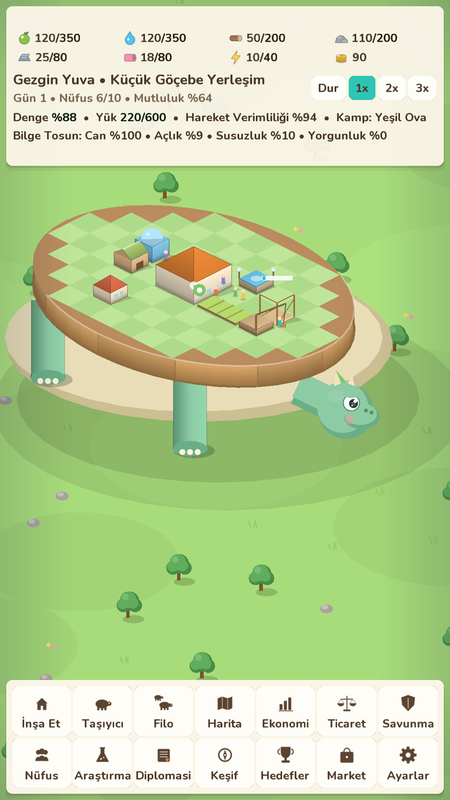
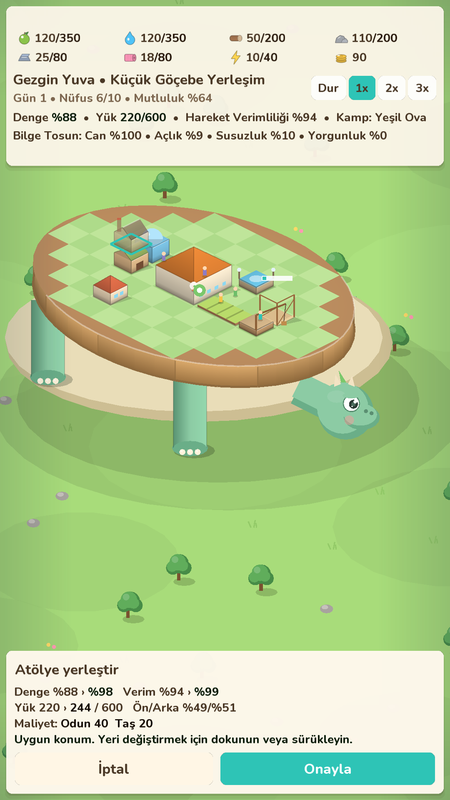
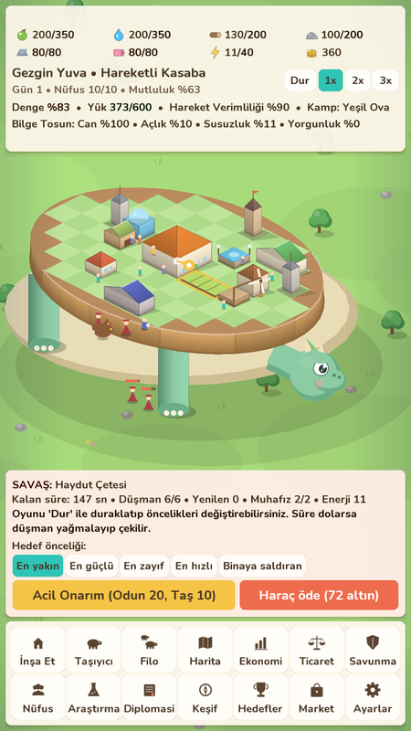
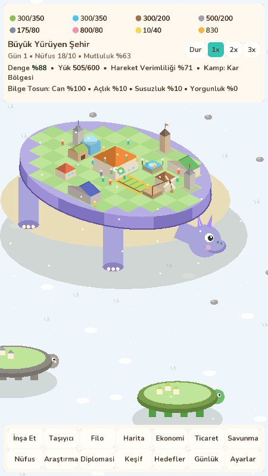

# Yürüyen Şehir: Göçebe Medeniyet

> Şehrini kur, taşıyıcını koru, dünyayı keşfet ve medeniyetini büyüt.

Dev bir taşıyıcı canlının sırtında kalıcı olarak büyüyen bir şehir kurma + hayatta kalma + keşif oyunu.
Android (dikey 9:16), Kotlin, libGDX. Tamamen çevrimdışı, tek oyunculu. Bölüm sistemi yok: tek şehir, sürekli gelişim.

<p>
 
 
</p>

## Bu sürümde (0.4.0) neler var

Geliştirme aşamalarından **1, 2, 3 tamamlandı; 4 temel düzeyde** çalışıyor; **5. aşama (ticaret, diplomasi, savunma, düşman yapay zekâsı, keşif) ve 6. aşama (süreklilik) tamamlandı**. Hepsi gerçek kod ve gerçek hesaplamadır; arayüzde işlevi olmayan buton yoktur.

| Sistem | Durum |
|---|---|
| Dev taşıyıcı (Dev Kara Kaplumbağası) | Can, açlık, susuzluk, yorgunluk, enerji, güven, seviye/deneyim; yürüme, nefes, dinlenme, göz kırpma animasyonları |
| Taşıyıcı gelişimi | 7 geliştirme dalı (kapasite, hız, dayanıklılık, verimlilik, arazi uyumu, savunma, sırt genişletme) + 3 özel yetenek |
| Ağırlık ve denge | Toplam ağırlık, kapasite, ağırlık merkezi, ön/arka ve sağ/sol dağılım, hareket verimliliği. Depolanan kaynaklar da ağırlık yapar ve depolara dağılır. Yerleştirirken anlık önizleme |
| Şehir inşası | 38 bina türü (37'si inşa edilebilir; istenen 35 binanın hepsi dahil), izometrik yerleşim, inşaat süresi, geliştirme (seviye), taşıma, onarım, kapatma, sökme |
| Komşuluk | Tarla + Su Deposu, Atölye + Malzeme Deposu, Ev + Sağlık Merkezi, Bakım Merkezi + Şehir Merkezi, Enerji + Üretim… gerçek üretim çarpanları |
| Ekonomi ve üretim zincirleri | 16 kaynak (8 temel + Alet, Atık + 6 gelişmiş), depo kapasiteleri, girdi eksikliğinde orantılı üretim, vergi ve bakım gideri |
| Nüfus | Barınma, büyüme, mutluluk (etken dökümüyle), sağlık, meslekler, binalara elle/otomatik çalışan atama |
| Araştırma | 7 dalda 21 kalıcı araştırma (hafif binalar, sulama, enerji tasarrufu, kas güçlendirme…) |
| Yolculuk (temel) | Tohumlu, sonsuz, 16x16 parça tabanlı dünya; 12 biyom; Hızlı ve Güvenli rota seçimi (A*), mesafe/süre/tehlike/erzak tahmini, keşif menzili |
| Yol olayları | Fırtına, kaynak, kervan, göçebeler, hastalık, sinyal, yırtıcı, kalıntı, nadir teknoloji — seçimli ve adil (binalar en fazla %20'ye düşer, asla yok olmaz) |
| Medeniyetler | 8 kültür (Tüccar Loncası, Kum Göçebeleri, Yaprak Klanı, Demir Birliği, Kristal Tarikatı, Göl Halkı, Fırtına Binicileri, Rakip Yürüyen Şehir). Dünya keşfedildikçe 12x12 bölgelerde deterministik olarak ortaya çıkarlar; göçebeler yer değiştirir, hepsi zamanla güçlenir |
| Ticaret | Arz-talep (stok), biyom kıtlığı, kültür tercihleri, ilişki, anlaşma ve itibara göre değişen alış/satış fiyatları; 10'luk alım-satım; ticaret menzili; Ticaret Pazarı ve Ticaret Deposu; kervanlar (uzak pazara satış, süre, haydut riski) |
| Diplomasi | 6 ilişki durumu (Düşman, Rakip, Tarafsız, Dost, Ticaret Ortağı, Müttefik); altın hediye, istenen kaynakla yardım, Ticaret Anlaşması, Geçiş İzni, İttifak, savaş ilanı ve barış görüşmesi. Kalıcı sonuçlar: ittifak geleneksel rakibi kızdırır, savaş itibarı düşürür ve baskınlar getirir, geçiş izni olmadan rakip sınırında ücret istenir, müttefikler yardım gönderir |
| Savunma ve savaş | Gerçek zamanlı, oyun hızıyla duraklatılabilen savaş. Gözetleme Kulesi (+menzil, erken uyarı), Savunma Kulesi (ok), Enerji Kulesi (atış başına enerji), Kalkan Merkezi (enerjiyle dolan kalkan), Muhafız Kışlası (düşmanı durduran muhafızlar). Genel ve kule başına hedef önceliği (en yakın, en güçlü, en zayıf, en hızlı, binaya saldıran), acil onarım ekipleri, haraç. Sonucu kule yerleşimi, düşmanın geldiği yön, enerji stoku ve rota seçimi belirler. Binalar en fazla %20'ye düşer, yağma savaş başındaki stokun %20'siyle sınırlıdır; çevrimdışıyken savaş ilerlemez |
| Düşman yapay zekâsı | 4 düşman türü: Haydut ve Akıncı depolara yönelip yağmalar, Mekanik Gözcü önce kuleleri hedefler, Vahşi Canlı en yakına saldırır; saniyede bir hedef yeniden değerlendirilir. Tehdit gücü günle ve biyom tehlikesiyle ölçülü artar; düşman medeniyetlerin baskınları güçleriyle büyür |
| Keşif ekipleri | Keşif Merkezi (seviye başına 1 ekip, 3 kişilik); 6 görev: Kaynak Bulma, Eski Yapı Araştırma, Ticaret Merkezi Keşfi, Yeni Medeniyet Bulma, Tehlike Tespiti, Nadir Teknoloji Arama. Risk (biyom, uzaklık, merkez seviyesi, Keşif Donanımı, yakın müttefik) ve ödül; görevler çevrimdışı da sürer |
| Taşıyıcı türleri ve koleksiyon | 8 tür (Dev Kara Kaplumbağası, Kristal Boynuzlu Dev, Uzun Bacaklı Gezgin, Kaya Sırtlı Dev, Orman Muhafızı, Çöl Gezgini, Buz Yürüyücüsü, Kadim Taşıyıcı); kapasite, hız, savunma, ihtiyaç, sırt alanı ve arazi uyumu farklı, görünümleri farklı. Keşif ekipleri türün yaşadığı biyomda bulur. Şehir sıfırlanmadan yeni taşıyıcıya aktarılır: binalar ve geliştirmeler korunur, yeni sırta sığmayan binalar listelenir |
| Yan şehirler ve göçebe filo | Boştaki taşıyıcılarla en fazla aşama-2 yan şehir; 6 uzmanlık (Tarım, Maden, Kereste, Ticaret, Bilim, Muhafız). Yan şehirler ana şehirle birlikte yürür, konvoyla mal gönderir, gerektiğinde ana şehrin erzakını kullanır, savaşta muhafız yollar. Filo en yavaş taşıyıcının hızıyla ilerler |
| Medeniyet uzmanlaşması | Ekonomi, Askerî, Keşif, Teknoloji, Doğa; Büyük Yürüyen Şehir aşamasında ikinci yön (hibrit) |
| Hedefler ve başarımlar | Her oyun günü yenilenen günlük hedefler (Görev Merkezi ile +1 ve %25 fazla ödül), 7 günlük haftalık hedefler, 20 başarım |
| Antik eserler | 10 eser; kalıntı kazıları ve keşif görevlerinde bulunur, her biri kalıcı avantaj verir |
| Sonsuz gelişim | Bütün araştırmalar bitince sınırsız Ustalık seviyeleri (her seviye +%2 üretim ve bilgi); rastgele ticaret fırsatları; Hava Gemisi İstasyonu ile uzak keşifler |
| Medeniyet itibarı | Ticaret, yardım ve anlaşmalarla artar; fiyatları ve yeni medeniyetlerin ilk tavrını etkiler |
| Medeniyet aşamaları | 7 unvan; aşamalar yeni binalar açar |
| Kayıt | Otomatik (30 sn + arka plana alınınca), CRC32 sağlama, yedek dosya, bozuk kayıtta yedekten yükleme; kayıt sürümü 4 (eski kayıtlar otomatik taşınır, testli) |
| Çevrimdışı ilerleme | En fazla 8 saat; üretim/inşaat/araştırma sürer, yolculuk ve olaylar durur, taşıyıcı dinlenir; saat geri alınırsa ilerleme yok |
| Ekranlar | Şehir (savaş çubuğu ve filoyla), Dünya haritası + rota (medeniyet ve keşif işaretleriyle), İnşa, Bina, Taşıyıcı (+gelişim, koleksiyon), Filo, Ekonomi (+zincirler, denge), Nüfus, Araştırma (+ustalık), Ticaret, Diplomasi, Savunma, Keşif, Hedefler ve Başarımlar (+uzmanlaşma, eserler), Dünya günlüğü, Ayarlar + İstatistikler |
| Diğer | Oyun hızı (Dur/1x/2x/3x), grafik kalitesi (düşük cihaz modu), Android geri tuşu, Türkçe karakter destekli yazı tipi |

### Henüz yapılmayanlar (sonraki aşamalar)

7. aşama (yayın hazırlığı): market ve kozmetikler (şehir özelleştirme), ses ve müzik, profesyonel çizimler, performans profili, Google Play hazırlığı (imzalı sürüm, mağaza metinleri).

## Proje yapısı

```
yuruyen-sehir/
  logic/     Saf Kotlin oyun mantığı (render'dan bağımsız, birim testli)
             GameCore, BuildingSystem, WeightBalanceSystem, ProductionSystem, EconomySystem,
             PopulationSystem, CarrierSystem, ResearchSystem, TravelSystem, EventSystem,
             WorldGenerator, StageSystem, SaveCodec/SaveManager
  core/      libGDX katmanı: YuruyenSehirGame, GameScreen + Panels (Scene2D arayüz),
             CityRenderer / BuildingArt / MapRenderer (ShapeRenderer ile çizim), Theme
  android/   AndroidLauncher, manifest, simgeler
  desktop/   Geliştirme için LWJGL3 başlatıcı ve ekran görüntüsü betiği
  assets/    Nunito yazı tipi (SIL OFL)
```

Görseller harici dosya kullanmadan kodla çizilir (izometrik kutular, taşıyıcı, zemin süsleri), bu yüzden APK küçüktür
ve düşük segment cihazlarda doku belleği sorunu yoktur.

## Çalıştırma

- **Android Studio:** `yuruyen-sehir` klasörünü proje olarak açın, `android` yapılandırmasını çalıştırın.
- **Komut satırı (APK):** `cd yuruyen-sehir && ./gradlew :android:assembleDebug` → `android/build/outputs/apk/debug/android-debug.apk`
- **Masaüstünde dene:** `./gradlew :desktop:run`
- **Testler:** `./gradlew :logic:test` (91 test: yerleşim, ağırlık/denge, üretim zinciri, nüfus, taşıyıcı, yolculuk, olaylar, araştırma, kayıt/yedek/sürüm geçişi, çevrimdışı, ticaret fiyatları, kervan, anlaşmalar, savaş/barış, kule/kalkan/muhafız, düşman hedef seçimi, yağma sınırı, keşif görevleri, taşıyıcı türleri ve aktarım, yan şehir/konvoy/filo hızı, uzmanlaşma, hedefler, başarımlar, eserler, ustalık)
- **Ekran görüntüleri:** `xvfb-run ./gradlew :desktop:screenshots` → `screenshots-local/`

Gereken: JDK 17+, Android SDK 35. `local.properties` içine `sdk.dir=...` yazın (Android Studio bunu kendisi yapar).

## Oynanış ipuçları

1. Başlangıçta **Tarla**, **Su Toplama Tesisi** ve **Toplayıcı Rampası** kurun; odun ve taş toplayıcıdan gelir.
2. Depolar başlangıçta arkadadır: denge çubuğunu izleyin, ağır binaları öne koyun.
3. Toplayıcının yatağı tükenir — yeni bölgelere yolculuk edin. Çölde su, dağda hız sorun olur.
4. Taşıyıcı bitkin düşerse yürümez; dinlendirin, **Taşıyıcı Bakım Merkezi** kurun.
5. Başlangıç bölgesinin doğusunda barışçıl bir **tüccar loncası** dolaşır: fazla malınızı satın, alet ve kumaş alın.
6. **Araştırma Merkezi** ile Hafif Kereste, Sulama Kanalları gibi kalıcı geliştirmeler yapın.
