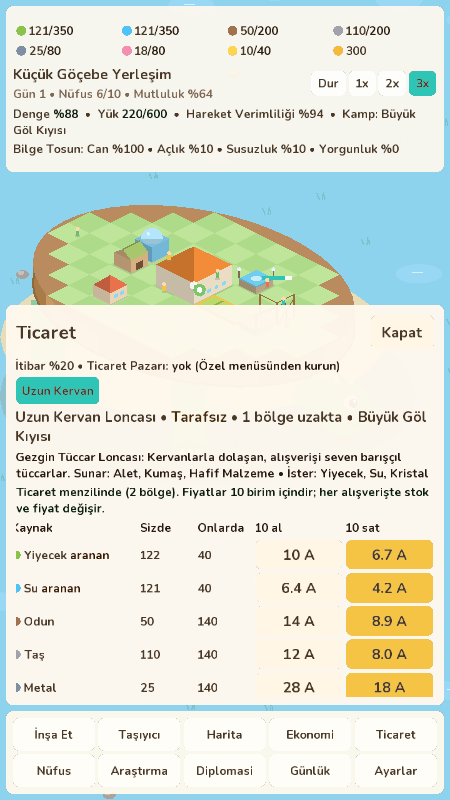
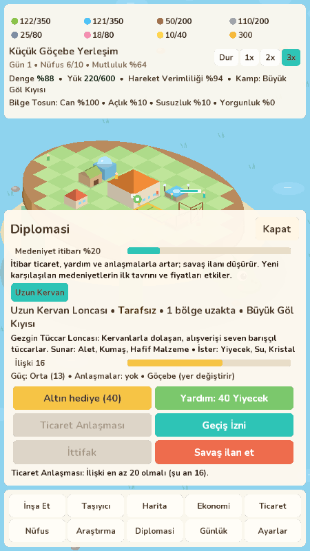

# Yürüyen Şehir: Göçebe Medeniyet

> Şehrini kur, taşıyıcını koru, dünyayı keşfet ve medeniyetini büyüt.

Dev bir taşıyıcı canlının sırtında kalıcı olarak büyüyen bir şehir kurma + hayatta kalma + keşif oyunu.
Android (dikey 9:16), Kotlin, libGDX. Tamamen çevrimdışı, tek oyunculu. Bölüm sistemi yok: tek şehir, sürekli gelişim.

<p>
 
 
</p>

## Bu sürümde (0.2.0) neler var

Geliştirme aşamalarından **1, 2, 3 tamamlandı; 4 temel düzeyde** çalışıyor; **5. aşamadan ticaret ve diplomasi** eklendi. Hepsi gerçek kod ve gerçek hesaplamadır; arayüzde işlevi olmayan buton yoktur.

| Sistem | Durum |
|---|---|
| Dev taşıyıcı (Dev Kara Kaplumbağası) | Can, açlık, susuzluk, yorgunluk, enerji, güven, seviye/deneyim; yürüme, nefes, dinlenme, göz kırpma animasyonları |
| Taşıyıcı gelişimi | 7 geliştirme dalı (kapasite, hız, dayanıklılık, verimlilik, arazi uyumu, savunma, sırt genişletme) + 3 özel yetenek |
| Ağırlık ve denge | Toplam ağırlık, kapasite, ağırlık merkezi, ön/arka ve sağ/sol dağılım, hareket verimliliği. Depolanan kaynaklar da ağırlık yapar ve depolara dağılır. Yerleştirirken anlık önizleme |
| Şehir inşası | 30 bina türü (29'u inşa edilebilir), izometrik yerleşim, inşaat süresi, geliştirme (seviye), taşıma, onarım, kapatma, sökme |
| Komşuluk | Tarla + Su Deposu, Atölye + Malzeme Deposu, Ev + Sağlık Merkezi, Bakım Merkezi + Şehir Merkezi, Enerji + Üretim… gerçek üretim çarpanları |
| Ekonomi ve üretim zincirleri | 16 kaynak (8 temel + Alet, Atık + 6 gelişmiş), depo kapasiteleri, girdi eksikliğinde orantılı üretim, vergi ve bakım gideri |
| Nüfus | Barınma, büyüme, mutluluk (etken dökümüyle), sağlık, meslekler, binalara elle/otomatik çalışan atama |
| Araştırma | 7 dalda 18 kalıcı araştırma (hafif binalar, sulama, enerji tasarrufu, kas güçlendirme…) |
| Yolculuk (temel) | Tohumlu, sonsuz, 16x16 parça tabanlı dünya; 12 biyom; Hızlı ve Güvenli rota seçimi (A*), mesafe/süre/tehlike/erzak tahmini, keşif menzili |
| Yol olayları | Fırtına, kaynak, kervan, göçebeler, hastalık, sinyal, yırtıcı, kalıntı, nadir teknoloji — seçimli ve adil (binalar en fazla %20'ye düşer, asla yok olmaz) |
| Medeniyetler | 8 kültür (Tüccar Loncası, Kum Göçebeleri, Yaprak Klanı, Demir Birliği, Kristal Tarikatı, Göl Halkı, Fırtına Binicileri, Rakip Yürüyen Şehir). Dünya keşfedildikçe 12x12 bölgelerde deterministik olarak ortaya çıkarlar; göçebeler yer değiştirir, hepsi zamanla güçlenir |
| Ticaret | Arz-talep (stok), biyom kıtlığı, kültür tercihleri, ilişki, anlaşma ve itibara göre değişen alış/satış fiyatları; 10'luk alım-satım; ticaret menzili; Ticaret Pazarı ve Ticaret Deposu; kervanlar (uzak pazara satış, süre, haydut riski) |
| Diplomasi | 6 ilişki durumu (Düşman, Rakip, Tarafsız, Dost, Ticaret Ortağı, Müttefik); altın hediye, istenen kaynakla yardım, Ticaret Anlaşması, Geçiş İzni, İttifak, savaş ilanı ve barış görüşmesi. Kalıcı sonuçlar: ittifak geleneksel rakibi kızdırır, savaş itibarı düşürür ve baskınlar getirir, geçiş izni olmadan rakip sınırında ücret istenir, müttefikler yardım gönderir |
| Medeniyet itibarı | Ticaret, yardım ve anlaşmalarla artar; fiyatları ve yeni medeniyetlerin ilk tavrını etkiler |
| Medeniyet aşamaları | 7 unvan; aşamalar yeni binalar açar |
| Kayıt | Otomatik (30 sn + arka plana alınınca), CRC32 sağlama, yedek dosya, bozuk kayıtta yedekten yükleme; kayıt sürümü 2 (0.1.0 kayıtları otomatik taşınır, testli) |
| Çevrimdışı ilerleme | En fazla 8 saat; üretim/inşaat/araştırma sürer, yolculuk ve olaylar durur, taşıyıcı dinlenir; saat geri alınırsa ilerleme yok |
| Ekranlar | Şehir, Dünya haritası + rota (medeniyet işaretleriyle), İnşa, Bina, Taşıyıcı (+gelişim), Ekonomi (+zincirler, denge), Nüfus, Araştırma, Ticaret, Diplomasi, Dünya günlüğü, Ayarlar + İstatistikler |
| Diğer | Oyun hızı (Dur/1x/2x/3x), grafik kalitesi (düşük cihaz modu), Android geri tuşu, Türkçe karakter destekli yazı tipi |

### Henüz yapılmayanlar (sonraki aşamalar)

Savunma kuleleri ve taktik savaş (şu an savaş baskın olaylarıyla ve savunma geliştirmeleriyle yürür), keşif ekipleri,
ek taşıyıcı türleri, yan şehirler ve göçebe filo, günlük/haftalık hedefler, başarımlar, market ve kozmetikler, ses.
Bunlara ait binalar (Gözetleme/Savunma Kulesi, Kalkan Merkezi, Kışla, Görev Merkezi, Keşif Merkezi,
Hava Gemisi İstasyonu) işlevleri yazılmadan menüye konmadı.

## Proje yapısı

```
yuruyen-sehir/
  logic/     Saf Kotlin oyun mantığı (render'dan bağımsız, birim testli)
             GameCore, BuildingSystem, WeightBalanceSystem, ProductionSystem, EconomySystem,
             PopulationSystem, CarrierSystem, ResearchSystem, TravelSystem, EventSystem,
             WorldGenerator, StageSystem, SaveCodec/SaveManager
  core/      libGDX katmanı: YuruyenSehirGame, GameScreen + Panels (Scene2D arayüz),
             CityRenderer / BuildingArt / MapRenderer (ShapeRenderer ile çizim), Theme
  android/   AndroidLauncher, manifest, simgeler
  desktop/   Geliştirme için LWJGL3 başlatıcı ve ekran görüntüsü betiği
  assets/    Nunito yazı tipi (SIL OFL)
```

Görseller harici dosya kullanmadan kodla çizilir (izometrik kutular, taşıyıcı, zemin süsleri), bu yüzden APK küçüktür
ve düşük segment cihazlarda doku belleği sorunu yoktur.

## Çalıştırma

- **Android Studio:** `yuruyen-sehir` klasörünü proje olarak açın, `android` yapılandırmasını çalıştırın.
- **Komut satırı (APK):** `cd yuruyen-sehir && ./gradlew :android:assembleDebug` → `android/build/outputs/apk/debug/android-debug.apk`
- **Masaüstünde dene:** `./gradlew :desktop:run`
- **Testler:** `./gradlew :logic:test` (56 test: yerleşim, ağırlık/denge, üretim zinciri, nüfus, taşıyıcı, yolculuk, olaylar, araştırma, kayıt/yedek/sürüm geçişi, çevrimdışı, ticaret fiyatları, kervan, anlaşmalar, savaş/barış)
- **Ekran görüntüleri:** `xvfb-run ./gradlew :desktop:screenshots` → `screenshots-local/`

Gereken: JDK 17+, Android SDK 35. `local.properties` içine `sdk.dir=...` yazın (Android Studio bunu kendisi yapar).

## Oynanış ipuçları

1. Başlangıçta **Tarla**, **Su Toplama Tesisi** ve **Toplayıcı Rampası** kurun; odun ve taş toplayıcıdan gelir.
2. Depolar başlangıçta arkadadır: denge çubuğunu izleyin, ağır binaları öne koyun.
3. Toplayıcının yatağı tükenir — yeni bölgelere yolculuk edin. Çölde su, dağda hız sorun olur.
4. Taşıyıcı bitkin düşerse yürümez; dinlendirin, **Taşıyıcı Bakım Merkezi** kurun.
5. Başlangıç bölgesinin doğusunda barışçıl bir **tüccar loncası** dolaşır: fazla malınızı satın, alet ve kumaş alın.
6. **Araştırma Merkezi** ile Hafif Kereste, Sulama Kanalları gibi kalıcı geliştirmeler yapın.
